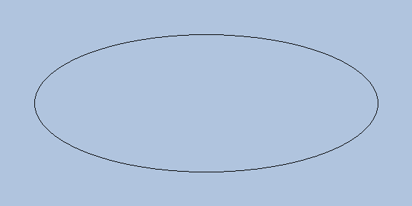

# 实验笔记：梯度裁剪

## 1 方法

损失为 $\mathcal{L}(\theta)=\frac{1}{N}\sum_{i=1}^{N}\ell_i$，梯度范数超过 $c$ 时按比例缩放：

$$g \leftarrow g\cdot\min\left(1,\frac{c}{\lVert g\rVert_2}\right)$$

## 2 结果

| 设置 | 准确率 | 损失 |
| --- | ---: | ---: |
| 无裁剪 | 88.2 | 0.41 |
| $c=1$ | 90.5 | 0.35 |

结论：裁剪阈值取 $c=1$ 最好。
